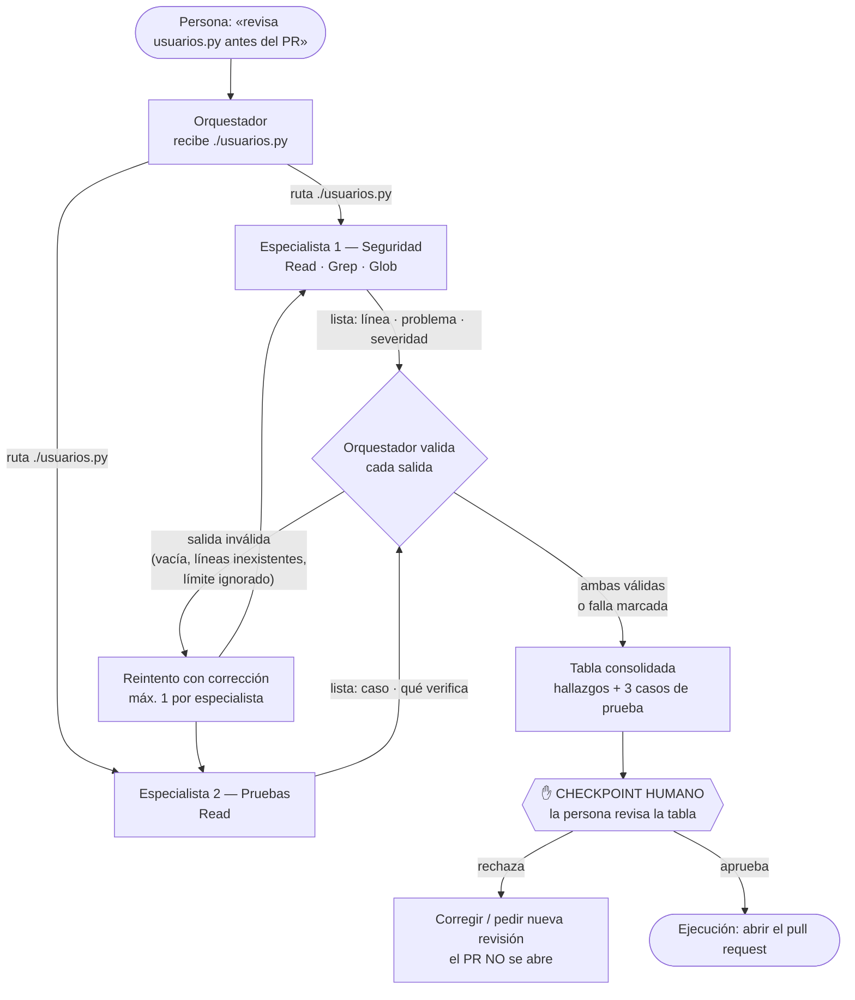
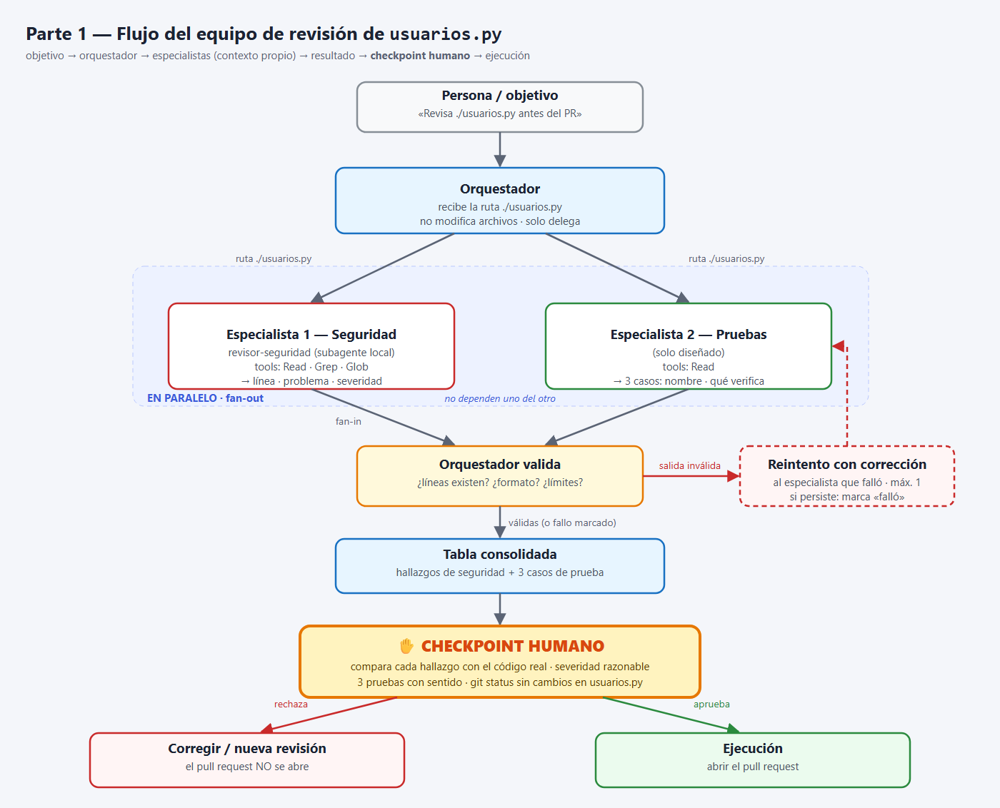
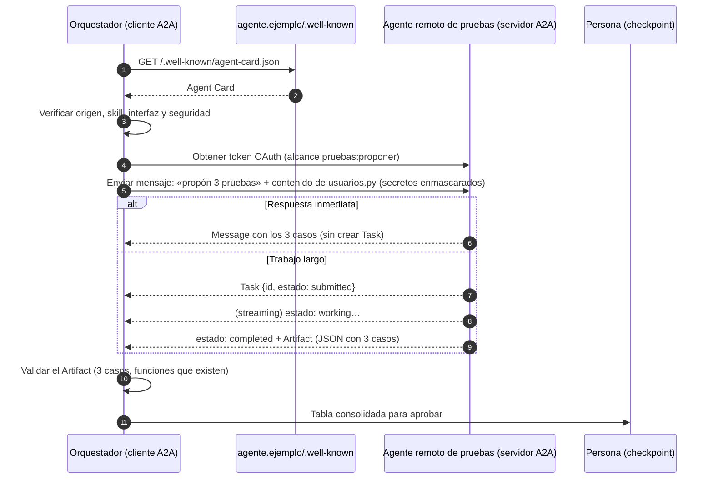
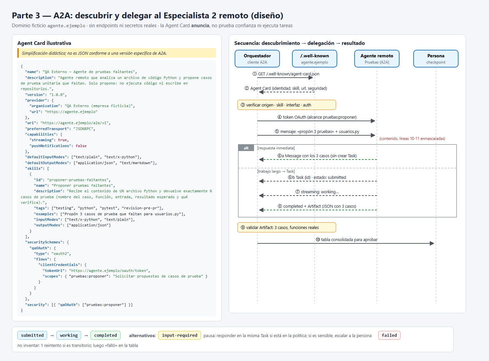

# Equipo de agentes — revisión de `usuarios.py` antes de un pull request

**Tarea:** antes de abrir un pull request, revisar el archivo **`usuarios.py`** (raíz del repositorio,
ruta relativa `./usuarios.py`) en dos dimensiones independientes: seguridad básica y pruebas faltantes.

```text
objetivo → orquestador → especialistas (contexto propio) → resultado → checkpoint humano → ejecución
```

---

## Parte 1 — Diseño del equipo

### Tabla de agentes

| Agente | Misión | Herramientas autorizadas | Entrada | Salida | Límites |
|---|---|---|---|---|---|
| **Orquestador** (agente principal de Claude Code) | Repartir la revisión de `./usuarios.py` entre los dos especialistas y consolidar lo que devuelven | Ninguna propia para el archivo (solo delega con la herramienta `Agent`) | Ruta del archivo: `./usuarios.py` | Una tabla consolidada con los hallazgos de seguridad y los 3 casos de prueba, más el estado de cada especialista (ok / reintentado / falló) | No modifica archivos; no inventa hallazgos propios; no abre el PR sin la aprobación de la persona |
| **Especialista 1 — Seguridad** (`revisor-seguridad`, implementado en [`.claude/agents/revisor-seguridad.md`](.claude/agents/revisor-seguridad.md)) | Buscar en `./usuarios.py` claves, contraseñas o tokens escritos en el código y entradas de usuario sin validar | `Read`, `Grep`, `Glob` (leer y buscar; **sin** `Write`, `Edit` ni `Bash`) | Ruta del archivo: `./usuarios.py` | Lista: **línea, problema, severidad** (alta / media / baja) | Solo ese archivo; no escribe ni ejecuta nada; enmascara los secretos que cita; si no encuentra nada, lo dice |
| **Especialista 2 — Pruebas** (solo diseñado) | Proponer **3** casos de prueba que faltan para las funciones de `./usuarios.py` | `Read` | Ruta del archivo: `./usuarios.py` | Lista: **nombre del caso y qué verifica** (función, entrada, resultado esperado) | Solo propone; no escribe ni ejecuta pruebas; exactamente 3 casos; cada caso debe referirse a una función que existe |

### Diagrama del flujo (paralelo + checkpoint humano)

Los dos especialistas **no dependen uno del otro**, así que el orquestador los lanza **en paralelo** (fan-out) y
espera a ambos antes de consolidar (fan-in). El **checkpoint humano** va **después de la consolidación y antes de
la ejecución** (abrir el pull request).





### Ejemplo de la tabla consolidada que entrega el orquestador

La parte de seguridad es la **salida real** del subagente `revisor-seguridad` (ver
[`evidencias/parte2_registro_delegacion.txt`](evidencias/parte2_registro_delegacion.txt)). La parte de pruebas es
la **salida esperada** del Especialista 2, que en este deber está solo diseñado (no se ejecutó).

| Origen | Línea | Hallazgo o caso de prueba | Severidad / qué verifica |
|---|---|---|---|
| Seguridad | 10 | Clave API escrita en el código: `API_KEY = "sk-demo-…"` | alta |
| Seguridad | 11 | Contraseña de administrador en texto plano: `ADMIN_PASSWORD = "admin123"` | alta |
| Seguridad | 21 | Inyección SQL: `nombre` se concatena dentro del `SELECT` | alta |
| Seguridad | 25-27 | `calcular_descuento` no valida tipo ni rango de `precio` y `porcentaje` | media |
| Seguridad | 30-36 | `crear_usuario` no valida `edad` (tipo y rango) ni el formato de `correo` | media |
| Seguridad | 42 | `es_admin` compara la clave con `==` contra un literal (sin tiempo constante) | alta |
| Pruebas *(esperado)* | 18-22 | `test_buscar_usuario_no_permite_inyeccion_sql` | Con `nombre = "x' OR '1'='1"` no debe devolver todos los usuarios (debe devolver `[]`) |
| Pruebas *(esperado)* | 25-27 | `test_calcular_descuento_rechaza_porcentaje_fuera_de_rango` | `porcentaje = 150` o `-10` debe lanzar `ValueError` en vez de dar un precio negativo o mayor |
| Pruebas *(esperado)* | 40-42 | `test_es_admin_rechaza_clave_incorrecta_y_vacia` | `es_admin("")`, `es_admin(None)` y `es_admin("Admin123")` devuelven `False` |

### Qué mira la persona antes de aprobar (checkpoint humano)

Antes de aprobar, la persona abre `usuarios.py` junto a la tabla y comprueba:

1. **Que cada hallazgo existe:** el número de línea y el fragmento citado coinciden con el código real
   (por ejemplo, que la línea 21 de verdad concatena `nombre`).
2. **Que la severidad es razonable:** una inyección SQL o una contraseña en el código es *alta*; una validación
   de rango que falta es *media*.
3. **Que los 3 casos de prueba tienen sentido:** apuntan a funciones que existen, tienen entrada y resultado
   esperado concretos, y no repiten el mismo caso con otro nombre.
4. **Que no falta nada evidente:** por ejemplo, que nadie haya pasado por alto la consulta concatenada.
5. **Que ningún agente modificó archivos:** `git status` no muestra `usuarios.py` modificado.

**La persona rechaza** si encuentra:

- un hallazgo en una línea que no existe o con un fragmento que no está en el código (alucinación);
- un hallazgo falso, como marcar `crear_usuario` como inyección SQL, cuando usa parámetros `?`;
- un caso de prueba sin sentido (una función inexistente, sin resultado esperado o que no prueba nada);
- un especialista que ignoró un límite (editó un archivo, revisó otros archivos, propuso 5 pruebas en vez de 3);
- secretos copiados completos en la salida, en lugar de enmascarados.

Si rechaza, **no se abre el PR**: se corrige o se pide una nueva revisión.

### Cómo detecta el orquestador que un especialista falló y qué hace

| Señal de fallo | Cómo se detecta | Qué hace el orquestador |
|---|---|---|
| **Salida vacía o sin formato** | La respuesta no contiene la tabla / lista esperada, o dice `ERROR:` | Reintenta **una vez** con el mismo encargo y le recuerda el formato exacto |
| **Inventa líneas o fragmentos** | Para cada hallazgo comprueba que la línea `n` existe (el archivo tiene 42 líneas) y que el fragmento citado aparece en esa línea | Descarta el hallazgo inventado y le **pide corrección** al especialista indicando cuál no existe; si vuelve a fallar, lo marca como «no verificado» |
| **Ignora un límite** | El especialista de pruebas devuelve ≠ 3 casos; alguno cita otro archivo; `git status` muestra cambios después de la revisión | Rechaza esa salida y pide corrección; si hubo cambios en archivos, **detiene el flujo y avisa a la persona** (no intenta revertir solo) |
| **No termina / error de la herramienta** | Tiempo de espera agotado o error al lanzar el subagente | Reintenta una vez; si persiste, consolida con lo disponible y marca la fila como **«Especialista N: falló»** |
| **Contradicción entre especialistas** | Un caso de prueba supone un comportamiento que seguridad marcó como fallo (o al revés) | No decide solo: lo **señala en la tabla** para que la persona lo resuelva en el checkpoint |

Regla general: **máximo un reintento automático** por especialista. Después de eso, el orquestador **no oculta el
fallo**: lo muestra en la tabla y deja que la persona decida en el checkpoint.

---

## A2A

**Escenario:** el **Especialista 2 (Pruebas)** ahora pertenece a **otra empresa** («QA Externo», ficticia) y corre en
su propio servidor. Mi orquestador ya no puede lanzarlo como subagente local: tiene que **descubrirlo** y
**delegarle una tarea** por red con el protocolo A2A (Agent2Agent).

### 1. Agent Card ilustrativa

> *Simplificación didáctica; no es JSON conforme a una versión específica de A2A.*

```json
{
  "name": "QA Externo — Agente de pruebas faltantes",
  "description": "Agente remoto que analiza un archivo de código Python y propone casos de prueba unitaria que faltan. Solo propone: no ejecuta código ni escribe en repositorios.",
  "version": "1.0.0",
  "provider": {
    "organization": "QA Externo (empresa ficticia)",
    "url": "https://agente.ejemplo"
  },
  "url": "https://agente.ejemplo/a2a/v1",
  "preferredTransport": "JSONRPC",
  "capabilities": {
    "streaming": true,
    "pushNotifications": false
  },
  "defaultInputModes": ["text/plain", "text/x-python"],
  "defaultOutputModes": ["application/json", "text/markdown"],
  "skills": [
    {
      "id": "proponer-pruebas-faltantes",
      "name": "Proponer pruebas faltantes",
      "description": "Recibe el contenido de UN archivo Python y devuelve exactamente N casos de prueba (nombre del caso, función, entrada, resultado esperado y qué verifica).",
      "tags": ["testing", "python", "pytest", "revision-pre-pr"],
      "examples": ["Propón 3 casos de prueba que faltan para usuarios.py"],
      "inputModes": ["text/x-python", "text/plain"],
      "outputModes": ["application/json"]
    }
  ],
  "securitySchemes": {
    "qaOAuth": {
      "type": "oauth2",
      "flows": {
        "clientCredentials": {
          "tokenUrl": "https://agente.ejemplo/oauth/token",
          "scopes": { "pruebas:proponer": "Solicitar propuestas de casos de prueba" }
        }
      }
    }
  },
  "security": [{ "qaOAuth": ["pruebas:proponer"] }]
}
```

Qué **anuncia** esta tarjeta: **identidad** (`name`, `provider`, `version`), **qué hace** (`description` y la
skill `proponer-pruebas-faltantes`), **dónde recibe solicitudes** (`url` + `preferredTransport`), una **capacidad**
pertinente (`streaming: true`: puede enviar el avance de la tarea mientras trabaja) y **qué seguridad exige**
(OAuth 2.0 *client credentials* con el alcance `pruebas:proponer`).

Qué **no** hace la tarjeta: **no ejecuta tareas** y **no prueba que el agente sea confiable**. Es un anuncio que el
propio proveedor publica sobre sí mismo; cualquiera puede publicar una tarjeta que diga «soy seguro». No contiene
secretos: dice *qué tipo* de credencial pide, no la credencial.

### 2. Dónde se obtiene la tarjeta y qué valida el cliente

**Dónde se obtendría** (de más a menos habitual):

1. **URL conocida** del proveedor: `https://agente.ejemplo/.well-known/agent-card.json`.
2. **Un registro o catálogo** interno de agentes aprobados por mi organización, que guarda la URL de la tarjeta.
3. **Configuración directa:** la otra empresa nos entrega la URL de la tarjeta al firmar el acuerdo.

**Validaciones del cliente (mi orquestador) antes de usarla:**

| Qué valida | Cómo |
|---|---|
| **Origen** | Se descarga solo por **HTTPS** con un certificado válido, y el dominio (`agente.ejemplo`) está en la **lista de proveedores permitidos** de mi organización. Si la tarjeta viene firmada, se verifica la firma. Que esté publicada **no basta** para confiar. |
| **Skill adecuada** | Existe una skill cuyo `id` es `proponer-pruebas-faltantes`, acepta `text/x-python` y devuelve `application/json`. Si no existe, no delego. |
| **Interfaz** | La `url` usa HTTPS, pertenece al mismo dominio permitido y el transporte (`JSONRPC`) es uno que mi cliente sabe hablar. |
| **Autenticación requerida** | Mi cliente tiene credenciales de OAuth *client credentials* para ese proveedor y pide **solo** el alcance `pruebas:proponer`. Si la tarjeta pidiera más permisos de los necesarios, no delego. |
| **Coherencia y vigencia** | La tarjeta es JSON válido con los campos mínimos, su versión es compatible y se vuelve a descargar periódicamente (no se usa una copia vieja en caché para siempre). |

### 3. Secuencia de delegación



En texto:

`obtener Agent Card` → `verificar skill, interfaz y seguridad` → `enviar mensaje (tarea + contenido del archivo)` →
`respuesta inmediata (Message)` **o** `Task` → `consultar/recibir el estado (streaming o consultando la Task por su id)` →
`obtener el resultado (Artifact)` → validar → checkpoint humano.

Una solicitud A2A **no siempre crea una Task**: si la propuesta es rápida, el agente remoto puede responder
directamente con un **mensaje**. La Task aparece cuando el trabajo tiene ciclo de vida (tarda, pide datos o se
puede cancelar).

> Diferencia importante con el subagente local: el agente remoto **no puede leer mi disco**, así que ya no le paso
> la **ruta** `./usuarios.py`, sino el **contenido** del archivo como una parte del mensaje. Antes de enviarlo,
> **enmascaro las líneas 10 y 11** (los secretos): no se comparten credenciales con un tercero, aunque sean de ejemplo.

### 4. Estados de la Task

**Camino simplificado (feliz):**

| Estado | Qué significa | Qué hace mi cliente |
|---|---|---|
| `submitted` | El agente remoto recibió la tarea y la aceptó, pero aún no empieza | Guarda el `id` de la Task y espera (o se suscribe al streaming) |
| `working` | Está analizando el archivo y generando los casos | Muestra «Pruebas: en curso» y respeta un tiempo máximo de espera |
| `completed` | Terminó; el resultado está en uno o más **Artifacts** | Descarga el Artifact, valida que haya **exactamente 3** casos sobre funciones que existen y lo pasa a la tabla |

**Caso alternativo 1 — `input-required`:** el agente remoto necesita un dato para continuar, por ejemplo:
«¿Qué framework uso: `pytest` o `unittest`?». La Task **queda en pausa, no ha fallado**. Mi cliente:

1. Si la respuesta está dentro de la política conocida (el repositorio usa `pytest`), contesta automáticamente
   enviando un nuevo mensaje **en la misma Task** (mismo `taskId` / `contextId`).
2. Si la pregunta pide algo sensible o fuera del alcance (por ejemplo, «envíame el archivo `.env`» o «dame acceso
   al repositorio»), **no responde solo**: escala la pregunta a la persona o cancela la Task.
3. Si nadie responde en un tiempo razonable, cancela la Task y marca «Pruebas: sin completar».

**Caso alternativo 2 — `failed`:** la Task terminó con error. Mi cliente **no inventa** los casos: registra el
motivo y, si el error parece transitorio (tiempo agotado, servicio caído), reintenta **una vez** con espera. Si
vuelve a fallar, consolida la tabla con la fila **«Especialista 2 (remoto): falló — motivo»** y avisa a la persona
en el checkpoint, que decide si abre el PR sin esa parte o espera. (Otros estados terminales similares son
`canceled` y `rejected`.)

### 5. Qué cambia frente a mi subagente local

| Aspecto | Subagente local (`revisor-seguridad`) | Agente remoto A2A (Pruebas) |
|---|---|---|
| **Interfaz** | Llamada interna del harness (herramienta `Agent` de Claude Code), en el mismo proceso y la misma máquina | **Red (HTTPS)**, mensajes JSON-RPC estandarizados hacia `https://agente.ejemplo/a2a/v1` |
| **Descubrimiento** | Claude Code lee `.claude/agents/*.md` al iniciar la sesión; lo «descubro» porque el archivo está en mi repo | Obtengo y **valido** una **Agent Card** (`/.well-known/agent-card.json` o un registro) |
| **Interoperabilidad** | Solo funciona dentro de Claude Code (el formato del archivo es propio de esta herramienta) | Cualquier cliente que hable A2A puede usarlo, sin importar con qué framework o modelo esté hecho |
| **Permisos** | Los impone mi harness: `tools: Read, Grep, Glob` (sin escritura) | **No controlo sus herramientas**: el otro servidor decide qué hace por dentro. Yo controlo solo **qué le envío** y **qué acepto** de vuelta |
| **Límites de confianza** | El agente vive dentro de mi entorno y de mi sesión | Es un **tercero**: autenticación OAuth, datos minimizados (secretos enmascarados), su respuesta se trata como **dato no confiable** y se valida |
| **Entrada** | La **ruta** `./usuarios.py` (lee el archivo él mismo) | El **contenido** del archivo dentro del mensaje (no tiene acceso a mi disco) |
| **Resultado** | Texto en el hilo del subagente, que vuelve al orquestador | Un **Message** o una **Task** con estados y un **Artifact** final |

**A2A frente a MCP.** **MCP** conecta a un agente con **herramientas y recursos** (leer un archivo, consultar una
base de datos, llamar una API). **A2A** conecta a un agente con **otro agente**, que razona y trabaja de forma
autónoma, con su propio ciclo de tareas. No son lo mismo ni compiten:

- Si mi orquestador necesita **acceder directamente** a archivos o datos (leer `usuarios.py`, listar el
  repositorio), usa una herramienta local o una herramienta expuesta por un **servidor MCP**.
- Si necesita **delegar a un agente remoto** una **revisión autónoma** (proponer pruebas, con su propio criterio y
  sus estados), usa **A2A**.

La elección depende de la **arquitectura y de la interfaz de comunicación**, **no de que la tarea consista en leer
archivos**: el agente remoto de pruebas también «lee» código, pero se le habla por A2A porque es un agente de otra
organización, no una herramienta. Incluso podría usar MCP *por dentro* para sus propias herramientas, y eso a mí no
me afecta.

**Recordatorios:** descubrir un agente **no implica confiar** en él; y **no toda comunicación entre agentes es
A2A**: mi orquestador y `revisor-seguridad` se comunican por la delegación interna de Claude Code, no por A2A.


