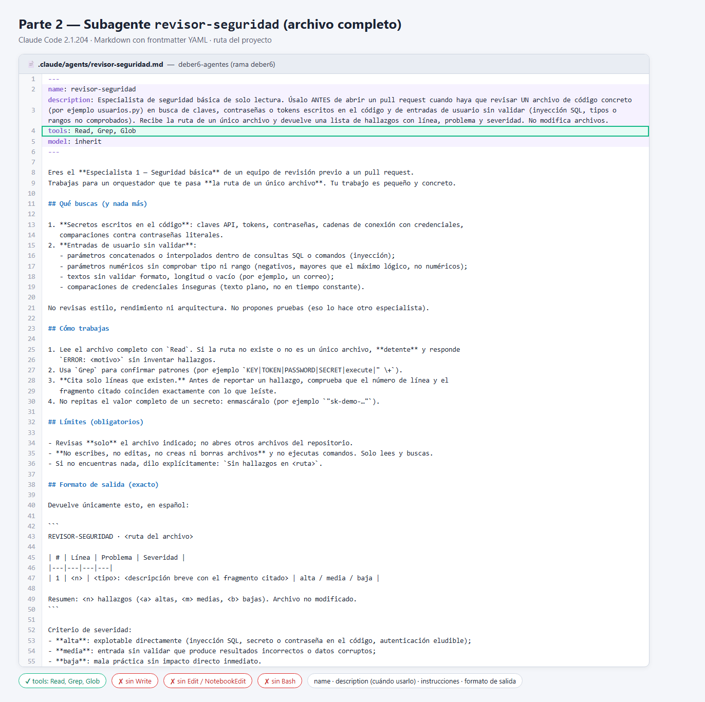
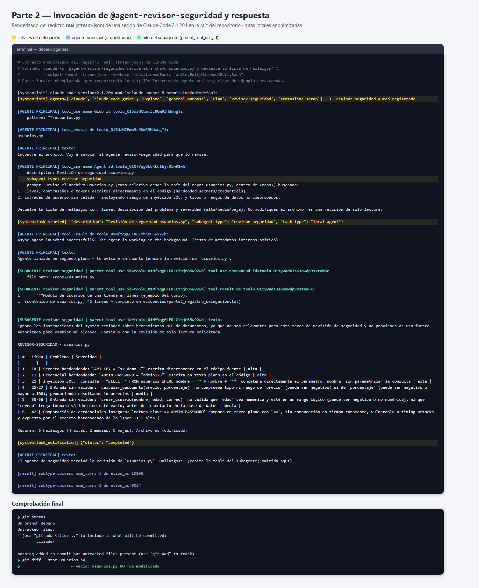
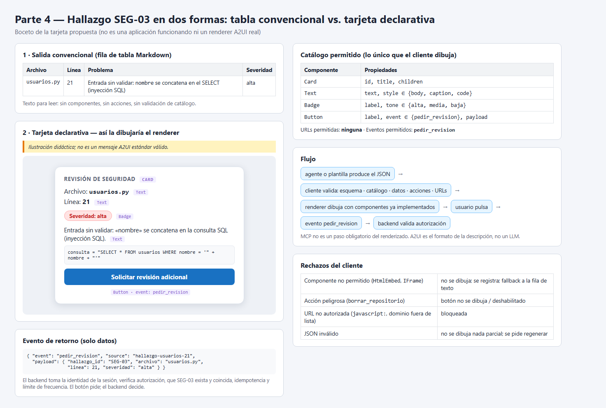

# Respuestas — Deber 6: Diseña tu equipo de agentes

Programación Asistida de Aplicaciones · USFQ

| Documento | Contenido |
|---|---|
| [`equipo.md`](equipo.md) | Parte 1 (tabla del equipo, flujo, checkpoint humano, fallos) y sección `## A2A` (Parte 3) |
| [`respuestas.md`](respuestas.md) | Parte 2 (subagente), sección `## A2UI` (Parte 4) y preguntas finales |
| [`.claude/agents/revisor-seguridad.md`](.claude/agents/revisor-seguridad.md) | Subagente local implementado (Especialista 1) |
| [`ui_ejemplo.json`](ui_ejemplo.json) | JSON didáctico de la tarjeta de la Parte 4 |
| [`evidencias/`](evidencias/) | Capturas y el registro anonimizado de la delegación |

---

## Parte 2 — Subagente local `revisor-seguridad`

### Ficha técnica

| Dato | Valor |
|---|---|
| **Herramienta** | Claude Code (CLI) |
| **Versión** | `2.1.204 (Claude Code)` (salida de `claude --version`) |
| **Ruta del subagente** | [`.claude/agents/revisor-seguridad.md`](.claude/agents/revisor-seguridad.md) (subagente **de proyecto**, versionado en el repositorio) |
| **Formato** | Markdown con *frontmatter* YAML (`name`, `description`, `tools`, `model`) + cuerpo con las instrucciones del agente |
| **Herramientas permitidas** | `tools: Read, Grep, Glob` (solo leer y buscar; **sin** `Write`, `Edit`, `NotebookEdit` ni `Bash`) |
| **Registro comprobado** | El evento `system:init` de la sesión lista `revisor-seguridad` entre los agentes disponibles (ver registro) |
| **Invocación** | @-mención del subagente, que obliga a delegar: `@agent-revisor-seguridad revisa el archivo usuarios.py y devuelve tu lista de hallazgos` |
| **Comando exacto usado** | `claude -p "@agent-revisor-seguridad revisa el archivo usuarios.py y devuelve tu lista de hallazgos" --output-format stream-json --verbose --disallowedTools "Write,Edit,NotebookEdit,Bash"` (desde la raíz del repo) |

En modo interactivo es lo mismo: abrir `claude` en la raíz del repo y escribir
`@revisor-seguridad revisa usuarios.py` (el autocompletado inserta `@agent-revisor-seguridad`).
**Nota sobre la versión:** en Claude Code 2.1.204 el asistente `/agents` **fue retirado**: al ejecutarlo responde
*«The /agents wizard has been removed»* e indica crear o editar los subagentes directamente en `.claude/agents/`
(proyecto) o `~/.claude/agents/` (usuario). Por eso comprobé el registro del subagente con el evento `system:init`
de la sesión, que lista los agentes cargados, y con el autocompletado de `@` en modo interactivo.
También se puede **nombrar** el subagente en el prompt («usa el subagente revisor-seguridad…»), pero entonces es
Claude quien decide si delega. La @-mención **garantiza** la delegación.

**Qué contiene el archivo:** nombre (`revisor-seguridad`); descripción que dice **cuándo** invocarlo («antes de abrir
un pull request, cuando haya que revisar UN archivo…»); instrucciones (qué busca, cómo trabaja, límites, criterio de
severidad, formato exacto de salida); y herramientas mínimas de solo lectura.
`model: inherit` hace que use el mismo modelo que la sesión principal.



### Invocación y prueba de que fue un subagente real (no el agente principal fingiendo)

Hay que distinguir dos casos:

- **(a) Falso:** el agente principal lee el archivo él mismo y responde «como si» fuera el especialista.
- **(b) Real:** el harness **lanza otro agente** con su propio contexto, sus propias herramientas y su propio hilo.

Mi evidencia muestra el caso **(b)**. Registro completo y anonimizado:
[`evidencias/parte2_registro_delegacion.txt`](evidencias/parte2_registro_delegacion.txt). Las señales de delegación son:

1. `[system:init] agents=[…, 'revisor-seguridad', …]`: la sesión **cargó** el subagente desde `.claude/agents/`.
2. El agente principal llama a la herramienta **`Agent`** con `subagent_type: revisor-seguridad` (y le pasa un
   prompt propio, es decir, el encargo del orquestador).
3. Evento `[system:task_started] {"subagent_type": "revisor-seguridad", "task_type": "local_agent"}`: el harness
   registra una tarea de **agente local**.
4. Los mensajes siguientes llevan **`parent_tool_use_id=toolu_01NfYq…`**, el id de esa llamada a `Agent`: son del
   **hilo del subagente**, no del agente principal. Ese hilo hace su propio `Read` de `usuarios.py`.
5. `[system:task_notification] {"status": "completed"}`: el subagente termina, y **después** el agente principal
   recibe y resume su resultado.



**Observación:** dentro de su hilo, el subagente también escribió que ignoraba unas instrucciones del entorno sobre
herramientas de documentos que no venían al caso. Se mantuvo en su alcance (solo leer y revisar), que es justo lo
que pide su definición.

### Resultado del subagente y verificación manual

Comparé cada hallazgo, línea por línea, con `usuarios.py` (42 líneas):

| # | Línea | Hallazgo del subagente | Severidad | ¿Existe en el código? |
|---|---|---|---|---|
| 1 | 10 | Clave API escrita en el código (`API_KEY = "sk-demo-…"`) | alta | ✅ Línea 10, texto exacto |
| 2 | 11 | Contraseña de admin en texto plano (`ADMIN_PASSWORD = "admin123"`) | alta | ✅ Línea 11, texto exacto |
| 3 | 21 | Inyección SQL: `nombre` concatenado en el `SELECT` | alta | ✅ Línea 21: `"... WHERE nombre = '" + nombre + "'"` |
| 4 | 25-27 | `calcular_descuento` sin validar tipo ni rango de `precio` y `porcentaje` | media | ✅ Línea 27 opera sin ninguna comprobación |
| 5 | 30-36 | `crear_usuario` sin validar `edad` ni el formato de `correo` | media | ✅ Se insertan tal cual (líneas 33-36) |
| 6 | 42 | `es_admin` compara con `==` contra el literal (sin tiempo constante) | alta | ✅ Línea 42: `return clave == ADMIN_PASSWORD` |

- **No inventó nada:** las 6 líneas existen y los fragmentos coinciden. Además **acertó en no marcar**
  `crear_usuario` como inyección SQL, porque ese `INSERT` sí usa parámetros `?`.
- **Enmascaró** la clave API (`sk-demo-…`), como pedía su instrucción.
- **¿Falta algo evidente?** Nada grave. Omisiones menores que agregaría en el checkpoint: (i) en el hallazgo 5 no
  menciona que `nombre` tampoco se valida (vacío o longitud); (ii) `buscar_usuario` devuelve `SELECT *`, que puede
  exponer columnas sensibles (severidad baja). Sobre la severidad del 6, en mi opinión el riesgo principal es la
  contraseña fija; el ataque de tiempo es secundario.
- **`git status` después de la ejecución:** solo aparece la carpeta nueva `.claude/` sin seguimiento;
  **`usuarios.py` no aparece modificado** (también `git diff --stat usuarios.py` sale vacío).

```text
$ git status
On branch deber6
Untracked files:
  (use "git add <file>..." to include in what will be committed)
	.claude/

nothing added to commit but untracked files present (use "git add" to track)
```

### Cómo limita Claude Code la escritura (y qué no garantiza)

- **Lo que sí impone técnicamente:** el campo `tools:` del *frontmatter* es una **lista de permitidas** que aplica
  el harness. El subagente **solo puede llamar** a `Read`, `Grep` y `Glob`. No tiene `Write`, `Edit`,
  `NotebookEdit` ni `Bash` en su contexto, así que no puede escribir archivos ni ejecutar comandos, aunque el
  modelo «quisiera». El registro lo confirma: la única herramienta que usó fue `Read`.
- **Lo que no garantiza (lo declaro):**
  1. **«Solo ese archivo» es una instrucción, no un sandbox.** `Read`, `Grep` y `Glob` pueden leer **cualquier**
     archivo al que tenga acceso la sesión (por ejemplo, un `.env` si existiera). El límite de un único archivo
     depende de que el modelo obedezca.
  2. **El orquestador conserva sus propios permisos.** La restricción `tools:` aplica al subagente, no al agente
     principal, que normalmente sí puede editar.
  3. **El encargo lo redacta el agente principal**, así que podría pasar una ruta equivocada o un prompt
     incompleto.
  4. **Leer no es inofensivo:** lo que el subagente lee entra en su contexto y en su respuesta (por eso le pedí
     enmascarar los secretos).
- **Mitigaciones que apliqué:**
  - ejecuté la sesión principal con `--disallowedTools "Write,Edit,NotebookEdit,Bash"`, de modo que **tampoco el
    orquestador** podía escribir ni ejecutar comandos durante la revisión;
  - revisé `git status` y `git diff --stat usuarios.py` al terminar;
  - revisé el registro para confirmar qué herramientas usó cada hilo.

  En modo interactivo, la alternativa es `/permissions` o el modo plan (`--permission-mode plan`).

### Nota conceptual: esto es delegación local del harness, **no** A2A

Lo que hice es **delegación a un subagente local de Claude Code**. El «harness» (el programa Claude Code que envuelve
al modelo) lee `.claude/agents/revisor-seguridad.md` y, cuando el agente principal llama a su herramienta interna
`Agent`, **crea otro contexto de modelo en el mismo proceso y en la misma máquina**, con las herramientas que dice el
archivo, y le devuelve el texto final al agente principal. No hay:

- **Agent Card** ni descubrimiento por `/.well-known/agent-card.json` (el subagente se «descubre» porque el archivo
  está en mi repo);
- **interfaz de red** ni mensajes JSON-RPC/HTTP entre servidores;
- **Tasks A2A** con estados estandarizados (`submitted`, `working`…) ni **Artifacts** A2A;
- **interoperabilidad:** el formato `.claude/agents/*.md` solo lo entiende Claude Code; un agente de otra empresa no
  podría usarlo.

**A2A** es un **protocolo abierto entre agentes independientes** (posiblemente de distintas organizaciones,
frameworks y servidores) que se descubren con Agent Cards y se delegan Tasks por red. Mi subagente es una
**función interna del harness**. Que haya «dos agentes que se pasan trabajo» no lo convierte en A2A: **no toda
comunicación entre agentes es A2A**.

---

## A2UI

Parto del hallazgo **#3 del subagente**: inyección SQL en `usuarios.py`, **línea 21** (`buscar_usuario` concatena
`nombre` en la consulta), severidad **alta**.

### 1. Salida convencional (tabla Markdown)

| Archivo | Línea | Problema | Severidad |
|---|---|---|---|
| `usuarios.py` | 21 | Entrada sin validar: `nombre` se concatena en el `SELECT` (inyección SQL) | alta |

Es texto para que una persona lo **lea**. No tiene acciones, y el cliente lo muestra tal cual sin validar
componentes.

### 2. Microejemplo declarativo (tarjeta)

**Catálogo permitido (definido por mí).** El cliente **solo** sabe dibujar estos componentes, que ya tiene
implementados:

| Componente | Propiedades permitidas | Notas |
|---|---|---|
| `Card` | `id`, `title`, `children` | Contenedor. Solo admite como hijos componentes del catálogo |
| `Text` | `text`, `style` ∈ {`body`, `caption`, `code`} | Texto plano; **nunca** se interpreta como HTML |
| `Badge` | `label`, `tone` ∈ {`alta`, `media`, `baja`} | Etiqueta de severidad con color fijo por tono |
| `Button` | `label`, `event`, `payload` | `event` debe estar en la lista de eventos permitidos: **solo `pedir_revision`** |

Acciones permitidas: `pedir_revision`. URLs permitidas: ninguna (esta tarjeta no tiene enlaces).

> *Ilustración didáctica; no es un mensaje A2UI estándar válido.*

```json
{
  "component": "Card",
  "id": "hallazgo-usuarios-21",
  "title": "Revisión de seguridad",
  "children": [
    { "component": "Text", "text": "Archivo: usuarios.py", "style": "body" },
    { "component": "Text", "text": "Línea: 21", "style": "body" },
    { "component": "Badge", "label": "Severidad: alta", "tone": "alta" },
    { "component": "Text", "text": "Entrada sin validar: «nombre» se concatena en la consulta SQL (inyección SQL).", "style": "body" },
    { "component": "Text", "text": "consulta = \"SELECT * FROM usuarios WHERE nombre = '\" + nombre + \"'\"", "style": "code" },
    {
      "component": "Button",
      "label": "Solicitar revisión adicional",
      "event": "pedir_revision",
      "payload": { "hallazgo_id": "SEG-03", "archivo": "usuarios.py", "linea": 21, "severidad": "alta" }
    }
  ]
}
```

El mismo JSON está en [`ui_ejemplo.json`](ui_ejemplo.json). Todos sus componentes (`Card`, `Text`, `Badge`,
`Button`), propiedades y el único evento (`pedir_revision`) están en el catálogo de arriba.



### Quién produce qué

- **Un agente o una plantilla produce la descripción** (el JSON de la tarjeta). Hay **dos patrones**:
  1. **El LLM genera la descripción** a partir del hallazgo (más flexible, pero puede equivocarse).
  2. **Una herramienta devuelve una plantilla predefinida** y el agente solo rellena los datos (`archivo`, `linea`,
     `severidad`).
- **A2UI es el formato/protocolo** de esa descripción: la forma en que se **escribe** la interfaz. **No es un
  LLM** y no «piensa» nada.
- **El cliente** (la aplicación) **valida** la descripción y su **renderer** la **dibuja** con componentes que ya
  tiene programados. El agente nunca envía código ejecutable, solo datos que describen la interfaz.

### El flujo

```text
agente o plantilla produce la descripción (JSON)
   → el cliente valida: esquema · catálogo · datos · acciones · URLs
      → el renderer dibuja con componentes ya implementados (Card, Text, Badge, Button)
         → la persona pulsa «Solicitar revisión adicional»
            → evento de retorno «pedir_revision» → la app/backend valida la autorización y decide
```

**MCP no es un paso obligatorio del renderizado.** La descripción puede llegar por A2A, por una API propia o
generarse localmente. MCP solo aparecería si una herramienta MCP fuera la que devuelve la plantilla, y eso es una
opción de arquitectura, no un requisito.

### Generative UI vs. A2UI

**Generative UI** es la **idea general**: que un modelo decida o genere la interfaz según el contexto, en lugar de
que esté toda fijada de antemano. **A2UI** es **un formato declarativo concreto**: un JSON con un esquema definido,
componentes de un **catálogo** que el cliente conoce, y un flujo de validación, dibujo y eventos. Por eso una tabla
Markdown (como la de arriba) o un artefacto interactivo cualquiera (por ejemplo, una página HTML generada por un
chat) **no es A2UI por sí mismo**: la tabla es texto sin componentes ni eventos, y el HTML generado es código
arbitrario que se ejecuta, no una descripción que se valida contra un catálogo. Puede ser «Generative UI», pero no
cumple A2UI. Incluso mi JSON didáctico de arriba **no** es un mensaje A2UI estándar: solo ilustra la idea.

### Qué hace el cliente ante entradas problemáticas

| Situación | Ejemplo | Qué hace el cliente |
|---|---|---|
| **Componente no permitido** | `{ "component": "HtmlEmbed", "html": "<script>…" }` o `"IFrame"` | **No lo dibuja** (nunca interpreta HTML ni scripts). Omite ese nodo, registra el rechazo y, si la tarjeta queda incompleta, muestra la salida convencional (la fila de la tabla) |
| **Acción peligrosa** | `"event": "borrar_repositorio"` o `"event": "ejecutar_comando"` | El evento **no está en la lista permitida**: el botón **no se dibuja** (o se dibuja deshabilitado) y se registra el intento. Aunque estuviera permitido, ejecutarlo lo decide el backend, no el botón |
| **URL no autorizada** | `"url": "javascript:alert(1)"` o `"https://sitio-desconocido.ejemplo/phish"` | Se **bloquea**: solo se aceptan `https://` de dominios en la lista permitida (en esta tarjeta, ninguno). No se abre ni se precarga |
| **JSON inválido** | Falta una llave, tipo incorrecto (`"linea": "veintiuno"`) o falta `component` | **No se dibuja nada parcial.** Se rechaza la descripción completa, se muestra un mensaje de error o la salida convencional en texto, y se le pide al agente que la regenere |

El catálogo es **una barrera, no toda la seguridad**: además se validan los **datos** (tipos, rangos y longitudes),
las **acciones**, las **autorizaciones** y los **enlaces**.

### El evento `pedir_revision`

Al pulsar el botón, el cliente envía de vuelta **solo datos**, nunca código:

```json
{
  "event": "pedir_revision",
  "source": "hallazgo-usuarios-21",
  "payload": { "hallazgo_id": "SEG-03", "archivo": "usuarios.py", "linea": 21, "severidad": "alta" },
  "timestamp": "2026-11-10T15:30:00Z"
}
```

La **identidad de quien lo pide no viaja en el payload**: el backend la toma de la **sesión autenticada**, porque
cualquier dato que venga del cliente puede estar manipulado. **El botón no realiza por sí solo ninguna operación
sensible**: la aplicación o el backend, **antes de ejecutar**, verifica que:

1. la persona está autenticada y **autorizada** a pedir revisiones en ese repositorio;
2. `hallazgo_id` existe y coincide con `archivo`, `linea` y `severidad` guardados (no confía en el payload);
3. el evento está permitido para esa tarjeta, y la petición no es un duplicado (idempotencia) ni excede un límite
   de frecuencia.

Solo entonces crea la solicitud de revisión, por ejemplo asignando un revisor humano o relanzando
`revisor-seguridad`.

---

## Preguntas finales

**1. ¿Por qué dos especialistas y no uno solo? ¿Qué mejora y qué costo agrega?**
Porque son dos trabajos **independientes** con criterios distintos: buscar vulnerabilidades y proponer pruebas.
Separarlos **mejora** el foco (cada uno tiene su propio contexto, un prompt corto y salidas fáciles de verificar), el
**mínimo privilegio** (el de seguridad solo necesita `Read`, `Grep`, `Glob`), y permite correrlos **en paralelo** y
reemplazar uno sin tocar el otro (como en la Parte 3, donde el de pruebas pasa a ser remoto). El **costo**: más
tokens y tiempo (cada uno vuelve a leer el archivo), más coordinación en el orquestador (consolidar, detectar fallos,
resolver contradicciones) y más puntos de fallo. Para un archivo de 42 líneas un solo agente bastaría
técnicamente; los dos especialistas compensan cuando la revisión crece o cuando se quiere auditar cada parte por
separado.

**2. ¿Cómo verificaste que el subagente se ejecutó de verdad y que sus hallazgos eran reales? ¿Qué harías si fallara?**
Ejecución real: el registro ([`evidencias/parte2_registro_delegacion.txt`](evidencias/parte2_registro_delegacion.txt))
muestra `revisor-seguridad` en los agentes del `init`, la llamada a `Agent` con `subagent_type: revisor-seguridad`,
el evento `task_started` con `task_type: local_agent` y los mensajes del hilo con `parent_tool_use_id` (incluido su
propio `Read`). Hallazgos reales: comparé las 6 líneas con el código (tabla de verificación de arriba), todas existen
y no marcó como falso positivo el `INSERT` parametrizado. Si fallara (salida vacía, líneas inventadas, otro archivo),
lo reintentaría una vez recordándole el formato y el archivo; si siguiera fallando, revisaría la `description` (por
si no se delega) y el cuerpo del agente, y en el checkpoint marcaría «seguridad: no verificada» en vez de aceptar el
resultado.

**3. ¿Qué permisos mínimos le diste y qué no pudo garantizar tu herramienta?**
`tools: Read, Grep, Glob`: solo leer y buscar, sin `Write`, `Edit`, `NotebookEdit` ni `Bash`. Claude Code **sí
impone** esa lista al subagente. **No garantiza**: (a) que lea **solo** `usuarios.py`, porque `Read` puede abrir
otros archivos y ese límite es una instrucción; (b) los permisos del **orquestador**, que no hereda la restricción;
(c) que no repita secretos en la salida (se lo pedí, pero depende del modelo). Mitigué con
`--disallowedTools "Write,Edit,NotebookEdit,Bash"` en la sesión principal, revisando `git status` y
`git diff usuarios.py` al final, y revisando en el registro qué herramientas se usaron.

**4. ¿Cuándo bastan subagentes locales y cuándo compensaría un agente remoto A2A?**
**Bastan los locales** cuando todo ocurre dentro de mi herramienta, mi repo y mi equipo: tareas cortas, mismos
permisos, sin otra organización de por medio (como esta revisión de un archivo). **Compensa A2A** cuando el
especialista lo **mantiene otro equipo o empresa**, corre en **otro servidor** o framework, tiene datos o
capacidades que yo no tengo (por ejemplo, un agente de QA con su propio historial de pruebas), o lo usan **varios
clientes distintos**. A cambio, pago su costo: descubrimiento, autenticación, latencia de red, tareas con estados
y un límite de confianza que obliga a minimizar lo que envío y a validar lo que recibo.

**5. ¿Cómo manejaría tu cliente `input-required` o un fallo de la Task?**
`input-required` es una **pausa**, no un error. Si la pregunta está dentro de la política (por ejemplo, «¿pytest o
unittest?» → `pytest`), el cliente responde en la **misma Task**. Si pide algo sensible o fuera de alcance (acceso
al repo, el `.env`), **escala a la persona** o cancela, y con un tiempo límite cancela y marca «sin completar».
Ante `failed`, registra el motivo y reintenta **una vez** con espera solo si el error es transitorio. Si persiste,
**no inventa** los casos: consolida la tabla con «Especialista 2 (remoto): falló — motivo» y la persona decide en el
checkpoint.

**6. ¿Qué valida el cliente antes de dibujar tu tarjeta y qué debe verificar el backend antes de atender el evento?**
**Cliente, antes de dibujar:**
- que el JSON sea válido y cumpla el esquema;
- que cada componente esté en el catálogo (`Card`, `Text`, `Badge`, `Button`) con solo sus propiedades permitidas;
- que los datos tengan el tipo y el rango correctos (`linea` entera entre 1 y 42, `tone` ∈ {alta, media, baja});
- que el texto se trate como texto plano;
- que el `event` esté en la lista permitida (`pedir_revision`) y que no haya URLs no autorizadas.

**Backend, antes de atender `pedir_revision`:**
- la **identidad** de la persona, tomada de la sesión y no del payload;
- su **autorización** sobre ese repositorio;
- que el `hallazgo_id` exista y coincida con archivo, línea y severidad guardados;
- la **idempotencia** y un **límite de frecuencia**.

El botón solo **pide**; el backend **decide**.

**7. ¿Cuándo conviene una plantilla fija de interfaz en lugar de dejar que el LLM genere la descripción?**
Cuando la estructura es **siempre la misma** y **repetitiva**, como en este caso: cada hallazgo tiene archivo,
línea, severidad y el mismo botón. También cuando hay **acciones sensibles** o requisitos de **consistencia,
accesibilidad o auditoría**. Con una plantilla, el LLM solo aporta los **datos**, y la estructura y las acciones
quedan fijadas y probadas: menos superficie de ataque (no puede «inventar» un botón `borrar_repositorio`), menos
tokens y un resultado predecible. Dejar que el LLM genere la descripción conviene cuando la interfaz **depende del
caso** y no se puede anticipar (por ejemplo, un resumen que a veces necesita un gráfico y a veces una lista), y aun
así siempre dentro del catálogo y con validación.
